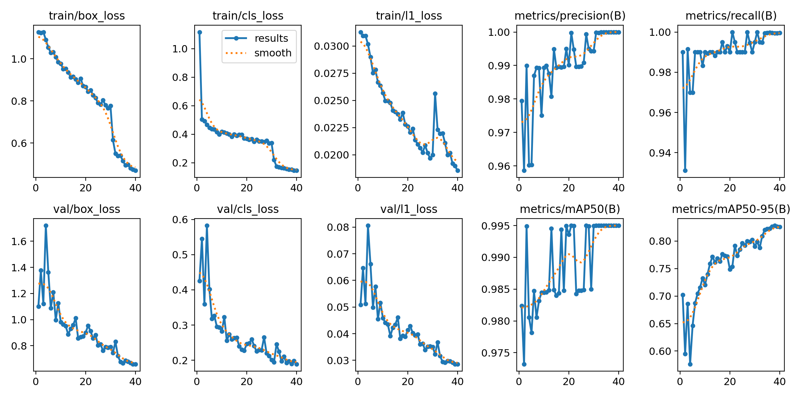

# Bird Detector (YOLO26n)

Проєкт для виявлення птахів на зображеннях та відеопотоці з використанням моделі **YOLO26n**.

---
## Структура проєкту та збережені артефакти

* `weights/best.pt` — найкращі збережені ваги моделі (38-ма епоха).
* `examples/input.mp4` — вхідне тестове відео.
* `examples/output.mp4` — результат роботи моделі з нанесеними bounding boxes, класом `bird` та показником confidence.
* `examples/input_2.mp4` — вхідне тестове відео.
* `examples/output_2.mp4` — результат роботи моделі з нанесеними bounding boxes, класом `bird` та показником confidence.
* `data/results.png` — графіки процесу навчання та валідації.

---
## Встановлення та запуск

1. Клонуйте репозиторій та встановіть залежності:
```bash
pip install -r requirements.txt
```

2. Підготовка датасету:
* Завантажте датасет за посиланням у розділі нижче (у форматі YOLO) та розпакуйте його у корінь проєкту в папку **`bird.v7i.yolo26_1014/`** (сама папка з даними виключена з репозиторію через `.gitignore`).

3. Запуск повноцінного навчання моделі:
* За замовчуванням скрипт шукає конфігурацію `bird.v7i.yolo26_1014/data.yaml`:
```bash
python train.py
```
* Якщо ви розпакували датасет в іншу директорію у корені проєкту (вона має містити `data.yaml`), передайте шлях через аргумент `--data`:
```bash
python train.py --data your_folder/data.yaml
```

4. Запуск швидкого тестового навчання (для слабкого ПК, 1 епоха, для перевірки працездатності на CPU):
```bash
python train.py --epochs 1 --batch 8
```
* Або із зазначенням іншої директорії датасету в корені:
```bash
python train.py --epochs 1 --batch 8 --data your_folder/data.yaml
```

5. Обробка відеофайлів навченою моделлю:
* Стандартний запуск (поріг впевненості за замовчуванням `0.4`, використовувалася для `input.mp4`):
```bash
python predict_video.py --input examples/input.mp4 --output examples/output.mp4
```
* Запуск зі зниженим порогом впевненості (для складних сцен, наприклад `input_2.mp4`):
```bash
python predict_video.py --input examples/input_2.mp4 --output examples/output_2.mp4 --conf 0.25
```
* Загальний шаблон для будь-якого вашого відео:
```bash
python predict_video.py --input шлях/до/відео.mp4 --output шлях/до/результату.mp4 --conf conf
```

---
## Датасет

Датасет було взято на ресурсі **roboflow.com**:
* **Назва:** bird > 2023-11-16 8:25pm
* **Джерело:** https://universe.roboflow.com/bird-om1so/bird-zhqxs
* **Ліцензія:** CC BY 4.0

---
## Метрики на Validation-вибірці
```text
=== НАЙКРАЩІ МЕТРИКИ (ЗБЕРЕЖЕНІ В best.pt) ===
Епоха: 38
Precision (Точність): 1.0000
Recall (Повнота): 0.9995
mAP50: 0.9950
mAP50-95: 0.8282

=== ОСТАННІ 3 ЕПОХИ ===
    epoch  metrics/precision(B)  metrics/recall(B)  metrics/mAP50(B)  
37     38                   1.0            0.99947             0.995   
38     39                   1.0            0.99939             0.995   
39     40                   1.0            0.99958             0.995   

    metrics/mAP50-95(B)  
37              0.82822  
38              0.82669  
39              0.82597 
```


---
## Проблеми, з якими довелося зіткнутися, та можливі покращення

### Виклики під час розробки:
1. **Апаратні обмеження (відсутність дискретної GPU NVIDIA):** Локальне тренування на центральному процесорі (CPU) займало близько 10 хвилин на одну епоху (понад 6.5 годин для повного циклу з 40 епох). Проблему вирішено шляхом перенесення процесу навчання у хмарне середовище Google Colab із використанням прискорювача Tesla T4 GPU.
2. **Мерехтіння рамок та коливання confidence на відео:** На динамічних кадрах, де птахи швидко рухаються або змінюють ракурс на складному фоні, показник впевненості (`confidence`) коливається в межах 0.65–0.85, а іноді відбувається короткочасна втрата детекції на окремих кадрах.
3. **Однорідність датасету (ризик Data Leakage):** Високі показники на валідаційній вибірці (`Precision = 1.0`, `mAP50 = 0.995`) свідчать про те, що використаний відкритий датасет містить аугментовані копії схожих кадрів у `train` та `valid` вибірках. Через це на реальному відео зі сторонніх джерел (Domain Shift) модель показує трохи нижчу, але все одно стабільну впевненість.
4. **Під час тестування на складних сценах** (колажі з поділом екрана та щільні зграї білих птахів на воді) **спостерігається зниження повноти детекції** (Recall) через перекриття об'єктів (роботу алгоритму NMS) та низький контраст. Зниження порогу впевненості (--conf 0.25) частково вирішує цю проблему.

### Можливі покращення:
* **Збагачення датасету:** Додавання зображень птахів у складніших умовах (різні ракурси, сутінки, дрібні об'єкти на великій відстані), а також «порожніх» кадрів фону (небо, дерева) для зменшення кількості хибних спрацьовувань.
* **Додавання трекінгу (Object Tracking):** Використання вбудованого в YOLO трекера (`model.track()`) замість покадрової детекції дозволить стабілізувати рамки між сусідніми кадрами та рахувати кількість унікальних птахів у відеопотоці.


